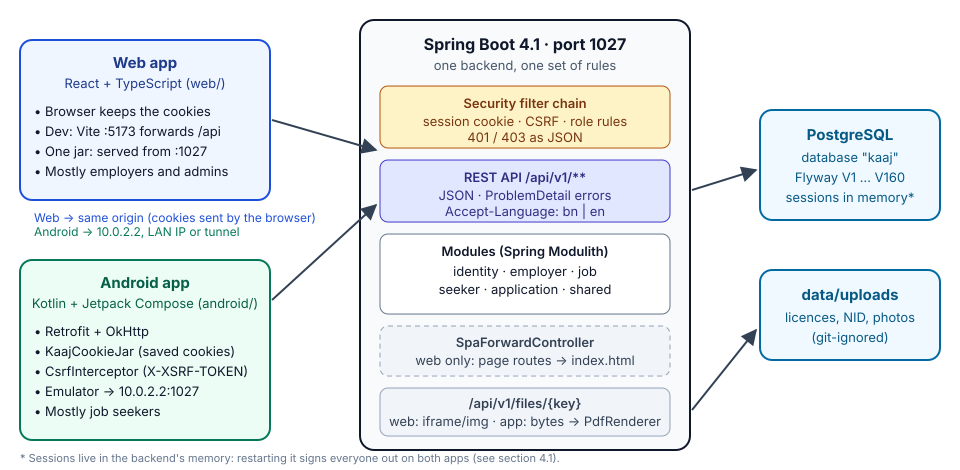

# One Spring Boot backend for the web app and the Android app

**Kaaj – The Job** · Ahsan Habib (22201027) · written 18 November 2026

This guide explains how the **same Spring Boot backend** in `studentapi` serves both front ends:

- the **web app** (`web/`, React + TypeScript), your CSE471 group project;
- the **Android app** (`android/`, Kotlin + Jetpack Compose), your single-member Kotlin course project.

It covers how each app talks to the backend, how to run both at once step by step, the places where the web and
the phone need different handling in the backend (the "exceptions"), the problems you are likely to hit, and how to fix each one.

> **The short version.** Both apps call the same URLs under `/api/v1`, send and receive the same JSON, sign in with the
> same session cookie, pass the same CSRF check and get the same error format. The backend doesn't know or care which app is
> calling. The differences are on the client side: the browser does cookies and CSRF for free, while the Android app
> does them in code (`KaajCookieJar` and `CsrfInterceptor`). A few backend settings exist for only one of the two apps,
> and section 4 lists every one of them.

## Contents

1. [The big picture](#1-the-big-picture)
2. [How each app talks to the backend](#2-how-each-app-talks-to-the-backend)
3. [Step by step: run the backend, the web app and the Android app together](#3-step-by-step-run-the-backend-the-web-app-and-the-android-app-together)
4. [Where the web and the phone differ in the backend (the exceptions)](#4-where-the-web-and-the-phone-differ-in-the-backend-the-exceptions)
5. [Problems you might face, and how to fix them](#5-problems-you-might-face-and-how-to-fix-them)
6. [Checklist: adding a new feature so that both apps keep working](#6-checklist-adding-a-new-feature-so-that-both-apps-keep-working)
7. [Later: options when the project grows](#7-later-options-when-the-project-grows)

---

## 1. The big picture



| Layer | Shared by both apps | Only one app |
|---|---|---|
| Database (PostgreSQL, Flyway `V1`…`V160`) | Everything: one database, one set of tables | — |
| Business rules (`app.kaaj.*` services) | Everything: verification, job status flow, 30-day expiry, matching, applications | — |
| REST API (`/api/v1/**`) | Every endpoint | Seeker endpoints (`/api/v1/me/**`, apply, saved jobs) have screens only in the Android app today; the web has a placeholder seeker page |
| Security (session cookie, CSRF, roles) | Same filter chain, same rules | — |
| Error format (ProblemDetail with `code`, `detail`, `errors`) | Same JSON for both | — |
| Language (`Accept-Language: bn` or `en`) | Same message files (`messages_bn.properties`, `messages.properties`) | — |
| `SpaForwardController` | — | **Web only**: sends page addresses such as `/employer/jobs` to `index.html` |
| `frameOptions(sameOrigin)` | — | **Web only**: lets the admin page show a PDF in an `<iframe>` |
| Swagger UI (`/swagger-ui.html`) | Developer tool for both | — |

**The rule that keeps this simple:** business rules live in the backend, never only in an app. Both apps check forms
before sending (so users get quick feedback), but the backend checks everything again and is the final judge. If you change
a rule, change it in the backend first, then copy the friendly check into each app.

## 2. How each app talks to the backend

| Topic | Web app (`web/src/lib/api.ts`) | Android app (`android/.../data/net/`) |
|---|---|---|
| Base address | Same site as the page: `/api/v1/...` (Vite forwards it in development; the jar serves it in production) | `http://kaaj.server/api/v1/` placeholder; `ServerInterceptor` swaps in the address from Settings (default `http://10.0.2.2:1027`) |
| Session cookie (`JSESSIONID`) | The browser stores and sends it automatically (`credentials: 'same-origin'`) | `KaajCookieJar` stores it; `PrefsCookieStorage` keeps it in SharedPreferences so you stay signed in after closing the app |
| CSRF token | Reads the `XSRF-TOKEN` cookie with `document.cookie`, sends it as the `X-XSRF-TOKEN` header on every POST/PUT/PATCH/DELETE | `CsrfInterceptor` does the same; if there is no token it calls `GET /api/v1/auth/csrf` first, and on a 403 it fetches a fresh token and retries once |
| Language | `Accept-Language` from i18next | `LanguageInterceptor` sends the app language |
| Errors | `ApiError(status, code, fieldErrors)` | `ApiException(status, code, fieldErrors)`; status 0 = server not reachable |
| Session ended (401) | `RequireRole` sends you to `/login?next=...` | `SessionInterceptor` sends you back to the sign-in screen |
| Uploads (licence, NID) | `FormData` from a file input | Camera, gallery or PDF picker; photos are turned upright and shrunk below 3 MB first (`DocumentFiles.kt`) |
| Viewing an uploaded file | `` or `<iframe src>`; the browser sends the cookie | Downloads the bytes with the same OkHttp client (so the cookie goes along), then shows them with `BitmapFactory` or `PdfRenderer` |
| Unknown JSON fields | Ignored (TypeScript only reads what it knows) | Ignored: `ignoreUnknownKeys = true` in `Network.json` |

**Sign-in flow, the same for both apps:**

1. `GET /api/v1/auth/csrf` → the backend answers `204` and sets the `XSRF-TOKEN` cookie.
2. `POST /api/v1/auth/login` with `{ "email", "password" }` and the header `X-XSRF-TOKEN: <cookie value>` → the backend answers with
   `{ id, email, role, locale }` and sets the `JSESSIONID` cookie.
3. Every later call sends both cookies; every change (POST, PUT, PATCH, DELETE) also sends `X-XSRF-TOKEN`.
4. `GET /api/v1/me` tells the app who is signed in (it is how both apps decide whether to show the sign-in screen at start-up).
5. `POST /api/v1/auth/logout` → `204`; the session is gone.

The same person can be signed in on the web and on the phone at the same time. They are **two separate sessions**: signing
out on the phone doesn't sign out the browser, and that is expected.

## 3. Step by step: run the backend, the web app and the Android app together

All commands are for **PowerShell** on Windows 11, run inside `C:\Users\UseR\Desktop\Projects\studentapi` unless a step says otherwise.

### Step 1 — Database and settings (once)

1. Make sure PostgreSQL is running and an empty database named `kaaj` exists:
   ```powershell
   psql -U postgres -c "CREATE DATABASE kaaj;"
   ```
2. Copy the settings template and put your PostgreSQL password in it (skip if `.env` already exists):
   ```powershell
   Copy-Item .env.example .env
   notepad .env
   ```
   `.env` is in `.gitignore` and must never be committed.

### Step 2 — Start the backend

```powershell
.\mvnw.cmd spring-boot:run "-Dspring-boot.run.profiles=dev"
```

- Keep the quotes: without them PowerShell splits the `-D...` argument at the dot.
- The `dev` profile loads the demo accounts (`karim@demo.kaaj`, `tongigarments@demo.kaaj`, `rahim@demo.kaaj`, `sumi@demo.kaaj`, `jamal@demo.kaaj`; password `Kaaj@12345`) and the admin from `.env`.
- Wait for `Started KaajApplication`. Leave this window open.

**Check it works** (in a second PowerShell window):

```powershell
curl.exe -i http://localhost:1027/api/v1/auth/csrf
```

You should see `HTTP/1.1 204` and a `Set-Cookie: XSRF-TOKEN=...` line. Use `curl.exe`, not `curl`: in Windows PowerShell 5, `curl` is a different command.
The API docs are at <http://localhost:1027/swagger-ui.html>.

### Step 3 — Start the web app

```powershell
cd web
npm install        # first time only (or npm ci)
npm run dev
```

Open <http://localhost:5173>. Vite forwards every `/api` call to port 1027, so to the browser the API and the pages come from
the same site and cookies and CSRF just work. Sign in as `karim@demo.kaaj` (employer) or the admin.

### Step 4 — Start the Android app on the emulator

1. In Android Studio choose **File → Open** and pick the **`android`** folder (not `studentapi`).
2. Wait for Gradle sync. If Android Studio asks which JDK to use for Gradle, choose its own bundled JDK (JetBrains Runtime). The backend
   uses JDK 25 and Android Studio uses its own JDK: two JDKs side by side is normal.
3. Start an emulator (Device Manager → ▶) and press **Run**.
4. The app talks to `http://10.0.2.2:1027`. Inside the emulator, `10.0.2.2` means "the computer running the emulator";
   `localhost` would mean the emulator itself.
5. Sign in as `rahim@demo.kaaj` (job seeker) or `karim@demo.kaaj` (employer).

### Step 5 — See that it is one backend

1. On the **web**, as `karim@demo.kaaj`, post a new job and publish it.
2. On the **phone**, as `rahim@demo.kaaj`, open **Find jobs** and pull to refresh: the new job is there.
3. Apply to it from the phone.
4. On the phone, sign in as Karim and open the job's **Applicants**: Rahim's application is there with its match score.
   (The web app has no applicants page yet; the endpoint `GET /api/v1/employer/jobs/{id}/applicants` is ready for it.)

This makes a good 30-second part of your Milestone 2 or Final video: two apps, one backend, the same data.

### Step 6 — Use a real phone

You have three ways. Pick the first one that works on your network.

**A. USB cable with `adb reverse` (works on any Wi-Fi, no firewall changes).**

```powershell
& "$env:LOCALAPPDATA\Android\Sdk\platform-tools\adb.exe" reverse tcp:1027 tcp:1027
```

Turn on USB debugging on the phone, connect it, run the command, then in the app's **Settings** set the server to
`http://localhost:1027`. The phone's port 1027 now leads to your computer's port 1027. Run the command again each time you reconnect the cable.

**B. Same Wi-Fi.**

1. Find your computer's address: `ipconfig` → "IPv4 Address" of the Wi-Fi adapter, for example `192.168.0.105`.
2. Allow port 1027 through Windows Firewall (PowerShell **as Administrator**, once):
   ```powershell
   New-NetFirewallRule -DisplayName "Kaaj backend 1027" -Direction Inbound -Protocol TCP -LocalPort 1027 -Action Allow -Profile Private
   ```
   Your Wi-Fi must be set to **Private** in Windows (Settings → Network & internet → Wi-Fi → your network → Private network).
3. In the app's **Settings**, set the server to `http://192.168.0.105:1027` (your own address).
4. University and café Wi-Fi often blocks devices from talking to each other. If the phone can't connect, use option A, or turn on the
   phone's hotspot and connect the computer to it.

**C. A public HTTPS address with a Cloudflare quick tunnel (free, no account).** Good for showing the app to someone who is not
next to you. Install `cloudflared`, then:

```powershell
cloudflared tunnel --url http://localhost:1027
```

It prints an address like `https://some-random-words.trycloudflare.com`. Put that in the app's Settings. The address changes every
time you start the tunnel and stops working when you press Ctrl+C. Anyone with the address can reach your backend, so stop it after the demo.

> Plain `http://` to an address other than `10.0.2.2` or `localhost` works only in **debug** builds: `src/debug/res/xml/network_security_config.xml`
> allows it. A release build needs `https://` (option C, or a real server).

### Step 7 — One jar for the web app (production style)

```powershell
.\mvnw.cmd -Pweb package
java -jar target\kaaj-0.1.0-SNAPSHOT.jar --spring.profiles.active=dev
```

- `-Pweb` builds the React app and puts it inside the jar, so <http://localhost:1027> now serves both the pages and the API.
- Run the jar from the `studentapi` folder, because `.env` is read from the current folder.
- The Android app doesn't change: it still uses port 1027.
- With the jar running, the tunnel in step 6C serves the web app too, at the same `https://...trycloudflare.com` address.

## 4. Where the web and the phone differ in the backend (the exceptions)

Each item says what is different, what the backend does today, and what to watch for.

### 4.1 Sessions and cookies

- **What differs:** a browser stores cookies on its own; a phone app has no cookie store unless you give it one.
- **Today:** one session-cookie login for both apps (`HttpSessionSecurityContextRepository`, `server.servlet.session.timeout=7d`,
  `http-only=true`, `same-site=lax`). Android uses `KaajCookieJar` + `PrefsCookieStorage`.
- **Watch for:** sessions are kept **in the backend's memory**. Every backend restart signs everyone out on both apps. In development
  that is only a small annoyance (the Android app goes back to the sign-in screen). If you need sessions to survive restarts, see section 7.1.
- **Watch for:** create **one** OkHttp client and use it for everything (API calls, file downloads). A second client would have no cookies
  and every call would get 401.

### 4.2 CSRF

- **What differs:** CSRF attacks need a browser that sends cookies automatically to another site. A native app is not exposed in the
  same way, but Spring Security checks every request the same way, so the app must still send the token.
- **Today:** `csrf.spa()`: the token is in the `XSRF-TOKEN` cookie and comes back in the `X-XSRF-TOKEN` header. The web app and `CsrfInterceptor` both do this.
- **Watch for:** the token changes when someone signs in. The interceptor's single retry on 403 covers that.
- **Don't** turn CSRF off for the whole backend to "fix" the app: it protects the web app. If you later move the app to bearer tokens,
  turn the check off only for requests that carry a token (section 7.2).

### 4.3 CORS

- **What differs:** CORS is a browser rule. The Android app never sends a CORS check, so CORS settings never affect it.
- **Today:** not needed. The web app reaches the API from the same site (the Vite proxy in development, the jar in production).
- **Watch for:** you only need CORS if the web app is hosted on a **different address** from the API (for example the pages on Netlify and
  the API on your PC through a tunnel). That also needs cross-site cookies (`SameSite=None; Secure`, HTTPS only) and a way to hand the
  CSRF token to a page on another site. It is much simpler to keep one address: serve the web app from the jar (step 7).

### 4.4 Page addresses (single-page app)

- **What differs:** a browser may open `/employer/jobs/123` directly; the phone never asks for pages.
- **Today:** `SpaForwardController` forwards any address that has no dot and doesn't start with `api`, `v3` or `swagger-ui` to `index.html`,
  up to four parts deep.
- **Watch for:** if you add a new non-API prefix (for example `/actuator`), add it to the exclusion list, or a typo in an app's URL will get
  the web page back instead of JSON. Keep every API under `/api/v1`.

### 4.5 Viewing uploaded files

- **What differs:** the web shows a PDF in an `<iframe>` and a photo in an ``; the browser sends the cookie. The phone has no
  browser frame, and image libraries such as Coil use their own HTTP client without your cookies.
- **Today:** `GET /api/v1/files/{key}` (signed-in users only; `FileAccessPolicy` checks who may see what) answers with `Content-Disposition: inline`,
  `Cache-Control: no-store, private` and `X-Content-Type-Options: nosniff`. `frameOptions(sameOrigin)` allows the web's iframe. The Android
  admin screen downloads the bytes with the shared client and draws them with `PdfRenderer` or `BitmapFactory`.
- **Watch for:** if you add image loading with Coil later, give Coil the same `OkHttpClient`.

### 4.6 Upload size

- **What differs:** phone camera photos are often 3–8 MB; files picked in a browser are whatever the user has.
- **Today:** `spring.servlet.multipart.max-file-size=3MB`, `max-request-size=4MB`, and `FileKind` limits each document to 3 MB. The Android
  app turns photos upright and shrinks them before upload. A bigger file gets `413` from Spring's built-in error handler.
- **Watch for:** if you raise the limit, raise both settings and `FileKind`. Keep shrinking photos on the phone anyway: it saves the user's mobile data.

### 4.7 Old app versions (the biggest difference)

- **What differs:** a new web version reaches every user the moment you deploy it. An installed Android app stays old until the user updates it,
  sometimes for months.
- **Today:** all endpoints are under `/api/v1`. The Android JSON reader ignores fields it doesn't know (`ignoreUnknownKeys = true`) and
  fills missing optional fields from defaults (`explicitNulls = false`, `coerceInputValues = true`).
- **Rules for the backend, from now on:**
  1. **Adding** a field to a response is safe.
  2. **Renaming or removing** a field, or changing its type, breaks old apps. Add the new field next to the old one and keep both until no
     old app is left, or make a `/api/v2` endpoint.
  3. **A new required request field** breaks old apps. Make it optional with a sensible default on the server.
  4. **A new value in an enum** (for example a new job status) breaks old apps where the Android model has no default for that field.
     Today `Job.status` has a default, but `ApplicationStatus` in `MyApplication` and `Applicant`, `VerificationStatus` in the admin list
     and the `allowedActions` list do not. Before a public release, give each enum field a default, or add an `UNKNOWN` entry, so an unknown value doesn't stop the whole screen.
- **Later:** an endpoint such as `GET /api/v1/app-config` that returns the lowest app version still supported, so a very old app can ask the user to update.

### 4.8 Language, numbers and dates

- **Today:** both apps send `Accept-Language`; the backend picks `messages_bn.properties` or `messages.properties` for error messages.
  Bangla digits, lakh grouping and dates are formatted in each app, not by the server. The server sends times as ISO-8601 instants in UTC.
- **Watch for:** add every new message key to **both** properties files. A key missing in Bangla quietly falls back to English.
  Show times in Bangladesh time (`Asia/Dhaka`, UTC+6) in the apps; never send a local date-time without a time zone.

### 4.9 Errors

- **Today:** every error is RFC 9457 ProblemDetail JSON: `status`, `title`, `detail` (in the user's language), `code` (for example `auth.required`,
  `job.not-editable`) and, for forms, `errors: { field: message }`. Both apps show `detail` and put each `errors` entry under the right input.
- **Watch for:** apps should make decisions on `code` and `status`, never on the wording of `detail`, which changes with the language.
  Keep `code` values stable once an app depends on them.

### 4.10 Slow and unreliable mobile networks

- **Today:** OkHttp waits 10 s to connect and 30 s for an answer. Creating a job and applying to a job send an `Idempotency-Key`, so if the
  phone retries after a dropped connection the backend doesn't create a second job or a second application. Lists are paged with cursors, not sent all at once.
- **Worth adding:** response compression saves mobile data on long job lists. Add to `application.properties`:
  ```properties
  server.compression.enabled=true
  server.compression.mime-types=application/json,application/problem+json
  ```
- **Watch for:** any new POST that creates something should take an `Idempotency-Key` too, for the same reason.

### 4.11 Plain HTTP and HTTPS

- **What differs:** a browser on `localhost` allows plain HTTP. Android 9 and later block plain HTTP unless the app allows it.
- **Today:** `network_security_config.xml` allows plain HTTP only to `10.0.2.2` and `localhost`; the debug build's copy allows all addresses
  (for a phone on the same Wi-Fi). Release builds must use HTTPS.

### 4.12 Role rules that matter more on the phone

- `/api/v1/me` (who am I) works for every signed-in user, but `/api/v1/me/**` (profile, saved jobs, applications) is **SEEKER only**.
  An employer screen that calls a `/me/...` address gets 403. Employer data lives under `/api/v1/employer/**`, admin data under `/api/v1/admin/**`.
- `POST /api/v1/jobs/{id}/applications` is SEEKER only; reading jobs (`GET /api/v1/jobs/**`) is open to everyone, so the phone can show jobs before sign-in.

### 4.13 Notifications (future)

- The web app can simply re-ask the server when a page opens. A phone app that should alert the user while closed needs push messages
  (Firebase Cloud Messaging, free). The backend would then store each phone's FCM token per user (a new table, `device_token`) and send a message
  when, for example, an application is shortlisted. Nothing changes for the web app.

## 5. Problems you might face, and how to fix them

| # | What you see | Why | Fix |
|---|---|---|---|
| 1 | Android: "Can't reach the server" / `Failed to connect to /10.0.2.2:1027` | The backend isn't running, or it is still starting | Start it (step 2) and wait for `Started KaajApplication`; try `curl.exe http://localhost:1027/api/v1/auth/csrf` on the PC |
| 2 | Real phone: connection times out | Wrong address, firewall, or the Wi-Fi blocks devices from each other | Use `adb reverse` (step 6A); otherwise check `ipconfig`, the firewall rule and the Private network setting (step 6B) |
| 3 | `CLEARTEXT communication to 192.168.x.x not permitted` | A release build, or the main network config, which allows HTTP only to `10.0.2.2` and `localhost` | Run the **debug** build, or use an `https://` tunnel address |
| 4 | Every POST/PUT answers **403** "You are not allowed to do this" while GETs work | The CSRF header is missing or old | Web: send every call through `api.ts`. Android: use the one shared OkHttp client with `CsrfInterceptor`. Postman: run `GET /auth/csrf` first and copy the cookie into `X-XSRF-TOKEN` |
| 5 | Web: signed in, but every call is 401 or 403 | The page was opened as `127.0.0.1:5173` but cookies were set for `localhost` (or the other way round) | Always open `http://localhost:5173` |
| 6 | Web: `Unexpected token '<'` or a blank page with API errors | The backend isn't running, so Vite returns `index.html` for `/api` | Start the backend; if it runs on another address, start Vite with `$env:KAAJ_BACKEND="http://host:port"; npm run dev` |
| 7 | Browser console: "blocked by CORS policy" | The web page comes from a different address than the API (for example `npm run preview` on port 4173, or a separate host) | Use `npm run dev` (with the proxy) or the one jar (step 7); add CORS only if you really host them apart (section 4.3) |
| 8 | Android: back at the sign-in screen after every backend restart | Sessions are in the backend's memory | Normal in development; see section 7.1 to keep sessions in PostgreSQL |
| 9 | Android: signed out every time the app is closed | Cookies kept only in memory | The app uses `PrefsCookieStorage`; if you change `AppContainer`, keep it |
| 10 | Upload fails with **413** | The file is bigger than 3 MB (4 MB for the whole request) | Phone: let the app shrink the photo; web: choose a smaller file or a photo instead of a scan |
| 11 | Admin: document preview blank on Android | The file was loaded without the session cookie (WebView, Coil or a new client) | Download with the shared client, as `AdminEmployerScreen` does |
| 12 | Web: PDF frame says "refused to connect" | `X-Frame-Options` blocks frames from another site | Keep the web app on the same address as the API; or open the file in a new tab |
| 13 | Bangla shows as `????` in the database or answers | The database was created with a non-UTF-8 encoding, or a file was saved in another encoding | `psql -U postgres -d kaaj -c "SHOW SERVER_ENCODING;"` must say `UTF8` (recreate the database with `ENCODING 'UTF8'` if not); save `.properties`, `.kt` and `.tsx` files as UTF-8 |
| 14 | Error messages in English while the app is in Bangla | The key is missing from `messages_bn.properties`, or `Accept-Language` isn't sent | Add the key to both files; check `LanguageInterceptor` and the web's i18n language |
| 15 | Android crashes or shows "Something went wrong" after a backend change | A field was renamed or removed, or a new enum value has no default (section 4.7) | Undo the rename (add, don't rename); give the Kotlin field a default or add an `UNKNOWN` enum entry |
| 16 | Backend won't start: `Migration checksum mismatch for migration version 150` | An SQL migration that already ran was edited | Never edit a migration that has run; add a new `V170__...sql`. In development only, you can drop and recreate the `kaaj` database |
| 17 | `Port 1027 was already in use` | A second backend is running (IDE and terminal, or a jar) | `Get-NetTCPConnection -LocalPort 1027 \| Select-Object OwningProcess` then `Stop-Process -Id <number>` |
| 18 | `password authentication failed for user "postgres"` | `.env` not found (jar started from another folder) or a wrong `DB_PASSWORD` | Run from the `studentapi` folder; check `.env` |
| 19 | Android Studio: no Run button / "no Gradle project" | You opened `studentapi` instead of `android` | File → Open → `android` |
| 20 | Gradle sync error on `compileSdk { version = release(37) }` | An older Android Gradle Plugin | Change it to `compileSdk = 37` in `android/app/build.gradle.kts` |
| 21 | Gradle error about the `org.jetbrains.kotlin.android` plugin | AGP 9 has Kotlin built in, so that plugin must not be added | Remove it; the project already uses AGP's built-in Kotlin |
| 22 | Employer on the phone gets 403 on a `/me/...` address | `/api/v1/me/**` is for job seekers only | Use the employer endpoints under `/api/v1/employer/**` |
| 23 | Times are 6 hours off | A UTC instant shown without converting to Bangladesh time | Format with `Asia/Dhaka` in the app; keep the server on UTC instants |
| 24 | Signing out on the phone doesn't sign out the browser | Two separate sessions (by design) | Expected. "Sign out everywhere" needs sessions in the database (section 7.1) |
| 25 | `.\mvnw.cmd test` skips the end-to-end tests | Docker Desktop isn't running (Testcontainers needs it) | Start Docker Desktop, or accept the skip; the unit tests still run |
| 26 | Modulith test fails: a module "depends on non-exposed type" | New code used another module's `internal` class | Use only the other module's top-level types (for example `JobDirectory`, `SeekerDirectory`) |

## 6. Checklist: adding a new feature so that both apps keep working

1. **Database:** a new Flyway file `V<next>__name.sql`. Never edit an old one.
2. **Backend:** service + controller under `/api/v1/...` in the right module; validation annotations; a `KaajException` with a message key for each failure.
3. **Security:** add the path to `SecurityConfig` with the right role.
4. **Messages:** add every new key to `messages.properties` **and** `messages_bn.properties`.
5. **Try it** in Swagger UI or Postman (remember the CSRF header).
6. **Web:** add the call in `web/src/lib/api.ts` (or the feature's API file), the types in `types.ts`, then the page.
7. **Android:** add the call to `KaajApi.kt`, the model to `Models.kt` (give new fields **default values**), the repository function, then the ViewModel and screen.
8. **Tests:** a backend test for the rule; a form test in each app if there is a form.
9. **Compatibility:** you only **added** fields; nothing was renamed or removed.
10. **Postman:** add the request to `postman/Kaaj_Member3.postman_collection.json` so the next person can try it.

## 7. Later: options when the project grows

### 7.1 Keep sessions when the backend restarts

Spring Boot can store sessions in PostgreSQL with the `spring-boot-starter-session-jdbc` starter. Because Flyway owns your database, add the
session tables as a migration instead of letting Spring create them:

1. Add the dependency to `pom.xml` (no version; Spring Boot manages it):
   ```xml
   <dependency>
       <groupId>org.springframework.boot</groupId>
       <artifactId>spring-boot-starter-session-jdbc</artifactId>
   </dependency>
   ```
2. Copy `org/springframework/session/jdbc/schema-postgresql.sql` from the `spring-session-jdbc` jar into a new migration, for example `V170__spring_session.sql`.
3. In `application.properties`: `spring.session.jdbc.initialize-schema=never`.
4. Restart twice and check that the phone stays signed in.

This also makes "sign out on all devices" possible later.

### 7.2 Tokens for the phone instead of cookies

Cookies work well for this project, and moving costs time, so only do this if you need it (for example native Google sign-in on Android
or other programs calling your API). The usual plan:

- The phone signs in and receives a short-lived access token plus a refresh token; it sends `Authorization: Bearer <token>`.
- The backend adds `oauth2ResourceServer(jwt)` to the same security chain and keeps the session login for the web app.
- CSRF stays on for cookie requests and is skipped only for token requests, for example
  `csrf.spa().ignoringRequestMatchers(request -> request.getHeader("Authorization") != null)`.
- The web app doesn't change.

### 7.3 Hosting both apps on the internet

- **Course demo:** your laptop + a Cloudflare quick tunnel (step 6C) is free and enough.
- **Real launch:** one server (or a free cloud VM) running the jar behind HTTPS on a real domain, a managed PostgreSQL, and the Android app
  built in release mode pointing at `https://api.<your-domain>`. The web app and the API stay on one address, so there is still no CORS.
- Back up the database and `data/uploads` together: one is useless without the other.

---

### Files this guide talks about

| File | What it does |
|---|---|
| `src/main/java/app/kaaj/identity/internal/SecurityConfig.java` | Session login, CSRF, role rules, JSON 401/403, frame options |
| `src/main/java/app/kaaj/identity/internal/AuthController.java` | `/auth/csrf`, `/auth/login`, `/auth/register`, `/me` |
| `src/main/java/app/kaaj/shared/internal/SpaForwardController.java` | Web-only page forwarding |
| `src/main/java/app/kaaj/shared/internal/FileController.java` | Serving uploaded files to both apps |
| `src/main/java/app/kaaj/shared/internal/ApiExceptionHandler.java` | ProblemDetail errors in Bangla or English |
| `src/main/resources/application.properties` | Port 1027, upload limits, session cookie, language files |
| `web/vite.config.ts` | Development proxy from port 5173 to port 1027 |
| `web/src/lib/api.ts` | The web app's API client (cookies, CSRF, errors) |
| `android/app/src/main/java/app/kaaj/android/data/net/Network.kt` | OkHttp client, JSON settings, `ApiException` |
| `android/app/src/main/java/app/kaaj/android/data/net/Interceptors.kt` | Server address, language, CSRF and session interceptors |
| `android/app/src/main/java/app/kaaj/android/data/net/KaajCookieJar.kt`, `PrefsCookieStorage.kt` | The Android app's cookie store |
| `android/app/src/main/res/xml/network_security_config.xml`, `android/app/src/debug/res/xml/network_security_config.xml` | Which addresses may use plain HTTP |

### Sources

- Spring Session with Spring Boot (JDBC store): <https://docs.spring.io/spring-session/reference/4.0/guides/boot-jdbc.html>
- Spring Boot 4 reference, Spring Session: <https://docs.spring.io/spring-boot/4.0/reference/web/spring-session.html>
- Cloudflare quick tunnels: <https://developers.cloudflare.com/tunnel/get-started/quick-tunnels/>
