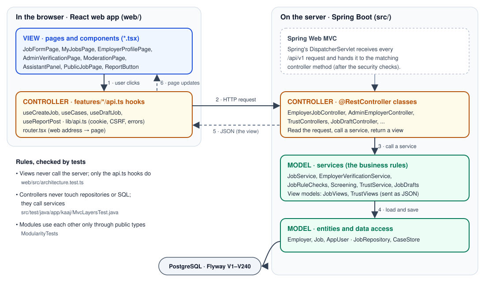

# How the web app follows MVC (Model–View–Controller)

**Kaaj – The Job**, CSE471 web app · Ahsan Habib (22201027), Member-3 · checked and written 19 November 2026

**Short answer: yes.** The web app has two halves, and both are split into Model, View and Controller:

- The **server** is built on **Spring Web MVC**, Spring's MVC framework. Controllers (`@RestController`) receive each request,
  services and entities (the Model) hold the rules and the data, and every answer is a view record sent as JSON.
- The **browser** half is the React app. Pages and components are the View. The `api.ts` hooks and the router are the Controller
  side: they send the user's actions to the server and hand the answer back to the page. Types, form rules and helpers are the Model.

Today's check found **five places that broke the rule**. They are fixed, and two new tests now fail the build if it is broken again
(section 5).

---

## 1. What belongs to each layer

| Layer | Its job | Server (`src/main/java/app/kaaj/`) | Browser (`web/src/`) |
|---|---|---|---|
| **Model** | The data and the business rules | **Entities**: `Employer`, `Job`, `AppUser` (with their state changes, for example `Job.publish`, `Job.hold`). **Services**: `EmployerProfileService`, `EmployerVerificationService`, `JobService`, `JobRules`, `JobRuleChecks`, `ScamPatterns`, `Screening`, `TrustService`, `JobDrafts`, `SentenceFacts`, `AuthService`, `UserAdminService`. **Data access**: `EmployerRepository`, `JobRepository`, `AppUserRepository` (Spring Data JPA), `CaseStore`, `JdbcTaxonomy`, `JdbcAuditLog` (SQL with `JdbcClient`). **Database**: Flyway migrations in `src/main/resources/db/migration/` | `lib/types.ts` (the shapes of the data), `features/*/schema.ts` (form rules and conversions, for example `validateJobForm`, `draftToForm`), `lib/trust.ts` (red-flag highlighting, note rules), `lib/format.ts` (taka, Bangla digits) |
| **View** | What the user sees | The **view records** that become JSON: `JobViews.JobView`, `JobViews.PublicJobView`, `TrustViews.CaseDetail`, `TrustViews.ScreeningView`, `AdminEmployerController.AdminEmployerView`, `AuthController.MeResponse` | Pages and components (`*.tsx`): `EmployerProfilePage`, `JobFormPage`, `MyJobsPage`, `JobDetailPage`, `AdminVerificationPage`, `ModerationPage`, `AssistantPanel`, `PublicJobPage`, `ReportButton`, `FindingList`; texts in `i18n/bn.json` and `en.json` |
| **Controller** | Takes the user's request, calls the model, picks the view | `@RestController` classes: `AuthController`, `EmployerProfileController`, `AdminEmployerController`, `EmployerJobController`, `PublicJobController`, `JobDraftController`, `TrustControllers`, `TaxonomyController`, `FileController`; `ApiExceptionHandler` turns errors into Bangla/English messages. Spring's `DispatcherServlet` routes each request to them | `features/*/api.ts` hooks (`useCreateJob`, `useJobAction`, `useCases`, `useCaseDecision`, `useDraftJob`, `useReportPost`, ...), `lib/api.ts` (the HTTP client: session cookie, CSRF token, errors), `router.tsx` (web address → page) |

**Why the views are JSON and React pages, not server-made HTML pages.** In Spring Web MVC a controller can return an HTML template
or data. Kaaj's controllers return data (JSON) because two front ends use the same server: this web app and the Android app. The
React app turns that data into the screen. The Model–View–Controller split is the same; only the place where the view is drawn moved
to the browser.

## 2. Each of Member-3's modules, layer by layer

| Module | Model | View | Controller |
|---|---|---|---|
| **1** Employer profile and verification | `Employer` (entity, verification states), `EmployerRepository`, `EmployerProfileService`, `EmployerVerificationService`; `employer-profile/schema.ts` | `EmployerProfilePage`, `VerificationPanel`, `AdminVerificationPage` | `EmployerProfileController`, `AdminEmployerController`; `employer-profile/api.ts`, `admin-trust/api.ts` (`useVerificationQueue`, `useDecision`) |
| **1** Post and manage jobs | `Job`, `JobStatus`, `JobRules`, `JobRepository`, `JobService`; `employer-jobs/schema.ts` | `JobFormPage`, `MyJobsPage`, `JobDetailPage`, `DashboardPage`, `JobCard`, `PublicJobPage`; `JobViews` | `EmployerJobController`, `PublicJobController`; `employer-jobs/api.ts`, `jobs/api.ts` (`usePublicJob`) |
| **2** Scam screening and moderation | `ScamPatterns`, `JobRuleChecks`, `Finding`, `JobContent`, `JobModeration`, `Screening`, `ScamReviewer`, `TrustService`, `CaseStore`, `UserAdminService`; tables `trust_case`, `report` (V240); `lib/trust.ts` | `ModerationPage`, `ReportButton`, `FindingList`, the screening notice on `JobDetailPage`; `TrustViews` | `TrustControllers`; `admin-trust/api.ts` (`useCases`, `useCaseDecision`), `jobs/api.ts` (`useReportPost`), `employer-jobs/api.ts` (`useScreening`) |
| **3** AI job-post assistant | `JobDrafts`, `SentenceFacts`, `DraftTemplate`, `OccupationFinder`, the AI client (`AiText`, `OpenAiCompatibleText`); `draftToForm` in `employer-jobs/schema.ts` | `AssistantPanel` (inside `JobFormPage`); the `JobDrafts.Draft` record | `JobDraftController`; `employer-jobs/api.ts` (`useDraftJob`) |

## 3. One click, traced through the layers

**An employer publishes a job post:**

1. **View** — `JobFormPage.tsx`: the employer fills in the four steps and presses **Publish**. The form is checked with
   `jobFormSchema`/`validateJobForm` (Model, `schema.ts`), then the page calls `create.mutateAsync(...)`.
2. **Controller (browser)** — `useCreateJob` in `employer-jobs/api.ts` sends `POST /api/v1/employer/jobs?submit=true` through
   `lib/api.ts`, which adds the session cookie and the CSRF token.
3. **Controller (server)** — `EmployerJobController.create` reads the JSON into a `JobInput` record, checks it with Bean Validation and
   calls `JobService.create`.
4. **Model** — `JobService` applies the rules (`JobRules`: a wage is required, a verified employer, ...), creates the `Job` entity and
   saves it with `JobRepository`. The `JobSubmitted` event starts `Screening` (Module 2), which publishes the post, holds it for
   review, or blocks it.
5. **View (server)** — the controller returns a `JobView` record as JSON (status `PUBLISHED`, `IN_REVIEW` or `BLOCKED`).
6. **Controller → View (browser)** — the hook refreshes the cached job lists (`useInvalidateJobs`), and the page shows the post with its status badge.

**An admin removes a scam post:** `ModerationPage` (View) → `useCaseDecision` (Controller, browser) →
`POST /api/v1/admin/cases/{id}/decision` → `TrustControllers.decide` (Controller) → `TrustService.decide` (Model: the note rule,
`JobModeration.block`, the audit log, the `JobRemovedAsScam` event) → `TrustViews.CaseDetail` (View, JSON) → the page shows the outcome.

## 4. What was checked and fixed on 19 November 2026

Every controller, service, page and component was checked against two rules: *controllers only call services*, and *views only
talk to the server through hooks*. Five files broke a rule:

| Where | The problem | The fix |
|---|---|---|
| `identity/internal/AuthController.java` | The sign-up rules (no admin sign-up, unique email, password hashing) and the database calls were inside the controller | Moved to a new service, **`AuthService.java`**. The controller now only reads the request and starts the session |
| `job/internal/JobSearchController.java` | Search and saved jobs read the database (`JobRepository`, `JobSearch`, `SavedJobs`) from the controller | Moved to a new service, **`JobSearchService.java`**. (This is Member-1's search, used by the Android app; it is not part of your group pushes) |
| `web/src/features/jobs/PublicJobPage.tsx` | The page called the server itself | Uses the new hook **`usePublicJob`** in `features/jobs/api.ts` |
| `web/src/components/ReportButton.tsx` | The component sent the report itself | Uses the new hook **`useReportPost`** in `features/jobs/api.ts` |
| `web/src/components/TaxonomyPicker.tsx` | The component searched occupations and skills itself | Uses the new hook **`useTaxonomySearch`** in `features/taxonomy/api.ts` |

The web addresses and the JSON did not change, so the web app and the Android app work exactly as before. After the fixes: the web
app type-checks, all 33 web tests pass and it builds; the three group pushes in guide 05 were rebuilt and each still builds on its own
(the earlier versions in `Doc/Guides/github-files/web/versions/` were updated too).

## 5. How the rules are kept

| Rule | Test | What it does |
|---|---|---|
| Controllers never touch repositories or SQL; they call services | `src/test/java/app/kaaj/MvcLayersTest.java` | Reads every `@RestController` class and fails if one has a `...Repository`, `JdbcClient`, `EntityManager` or SQL store (a class that uses `JdbcClient`) as a field. Plain Java, no database needed |
| Views never call the server; only the `api.ts` hooks do | `web/src/architecture.test.ts` | Reads every `.tsx` file and fails if one calls `api.get/post/put/patch/delete/upload`, `getOrNull` or `fetch` |
| Modules use each other only through their public (top-level) types | `src/test/java/app/kaaj/ModularityTests.java` | Spring Modulith's check, already in the project |

Run them with `.\mvnw.cmd test` and `cd web; npm test`. If a teammate adds a page that calls the server directly, `npm test` names
the file.

## 6. For the viva: likely questions

| Question | Answer |
|---|---|
| Where is MVC in your project? | Server: Spring Web MVC, with controllers in `*Controller.java`, the model in the services, entities and repositories, and view records in `JobViews`/`TrustViews`. Browser: React pages are the views, the `api.ts` hooks and the router are the controllers, and the types and form rules are the model. |
| Where are your models? | `Employer.java`, `Job.java` (entities with their rules), the repositories, and the services such as `JobService` and `TrustService`; tables come from the Flyway migrations. |
| Why don't you use JSP/Thymeleaf views? | The same server also feeds the Android app, so the controllers return JSON and each app draws its own screens. The MVC split stays the same. |
| What does a controller do in your code? | Reads and validates the request, finds the signed-in user, calls one service method, and returns a view record. Example: `TrustControllers.decide`. |
| How do you stop someone breaking the layers? | `MvcLayersTest`, `architecture.test.ts` and `ModularityTests` fail the build. |
| Show me your scam rules. | `JobRuleChecks.java` and `ScamPatterns.java` (Model), unit-tested by `JobRuleChecksTest` and `ScamPatternsTest`. |
