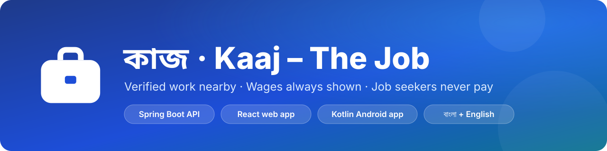
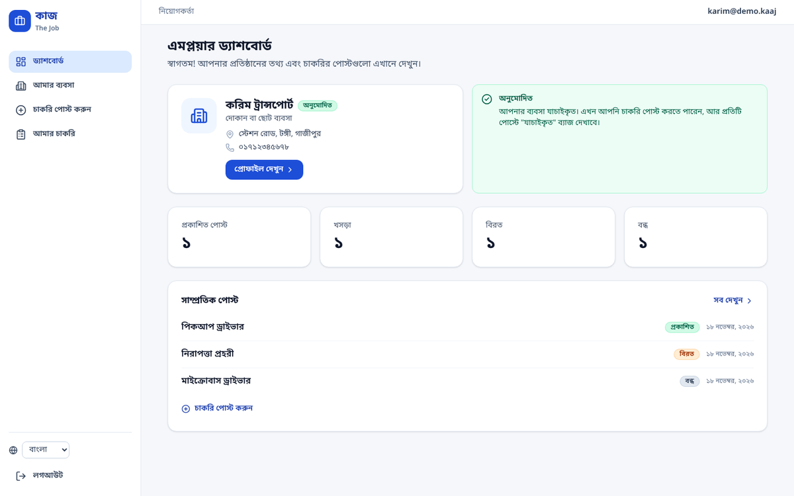
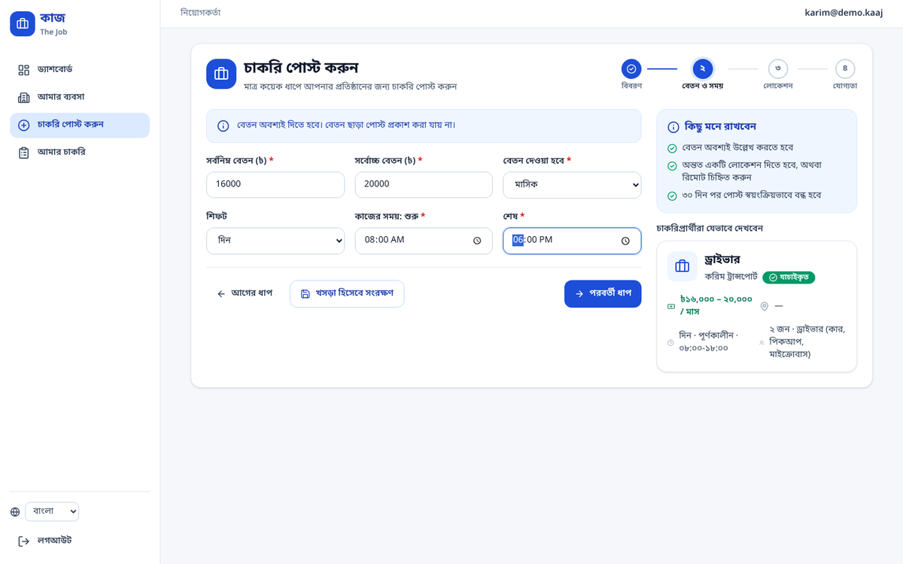
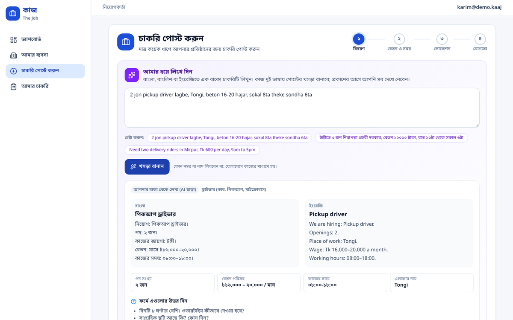
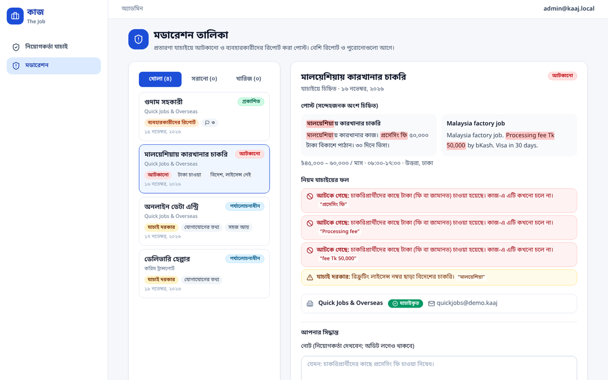
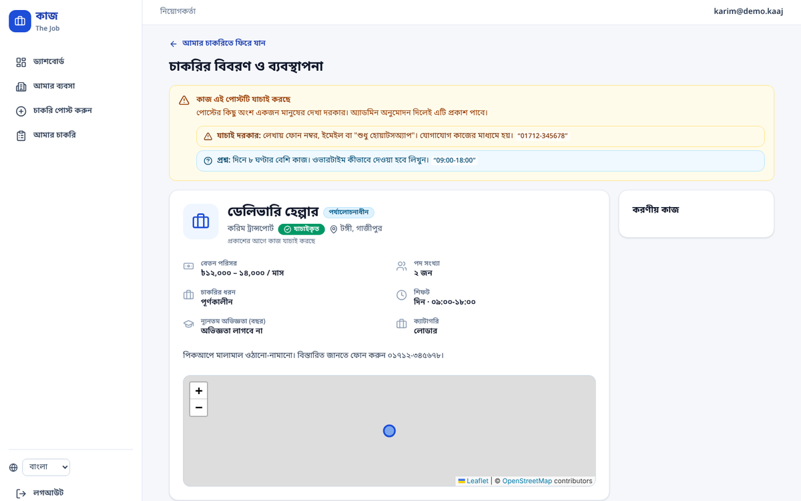
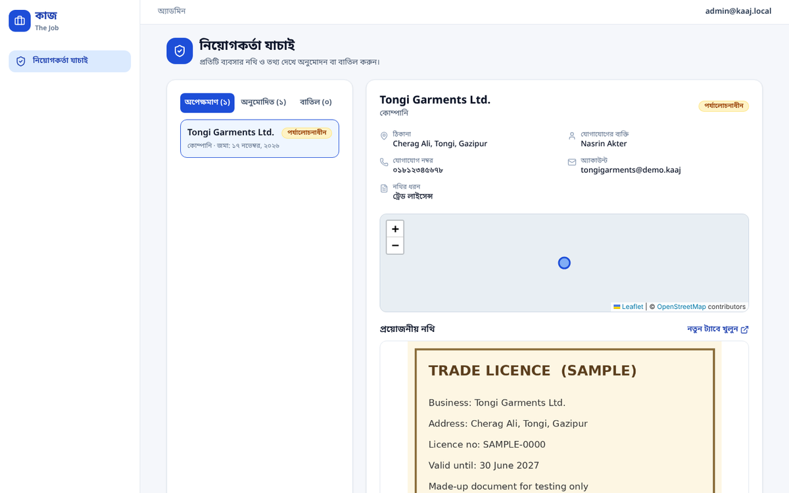
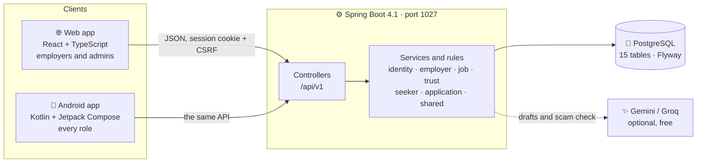
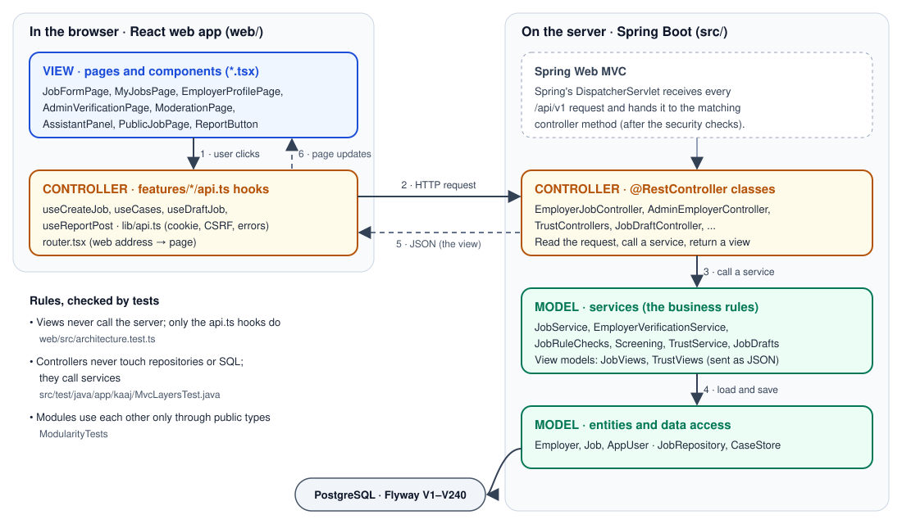

<div align="center">



<br/>

**A Bangla-first job platform for Bangladesh** that connects job seekers, first-time and blue-collar workers first,<br/>
with **verified employers**. One Spring Boot backend serves a React web app and a Kotlin Android app.

<br/>


-8E75B2?logo=googlegemini&logoColor=white)


[**Features**](#-features) · [**Screenshots**](#-screenshots) · [**Architecture**](#-architecture) · [**Quick start**](#-quick-start) · [**API**](#-api) · [**Guides**](#-guides)

</div>

---

> [!TIP]
> **New here?** Start with [`Doc/PROJECT_CONTEXT.md`](Doc/PROJECT_CONTEXT.md): the whole project in one file, what is built and
> checked, and what is still left. To run everything on Windows, follow [`Doc/Guides/04_Run_Backend_Web_Android.pdf`](Doc/Guides/04_Run_Backend_Web_Android.pdf).

## 🧭 At a glance

<table>
<tr>
<td width="33%" valign="top">

### 🌐 Web app
`web/` · React + TypeScript

The **CSE471 group project** (Member-3's modules): employer profile and verification, post and manage jobs, scam screening and
moderation, and the AI job-post assistant.

</td>
<td width="33%" valign="top">

### 📱 Android app
`android/` · Kotlin + Jetpack Compose

The **Kotlin course project** (single member), with every role: employers, admins **and job seekers**: search near me, save,
apply in one tap, track, ranked applicants.

</td>
<td width="33%" valign="top">

### ⚙️ Backend
`src/` · Spring Boot 4.1 · Java 25

One API for both apps on port **1027**: 7 modules, 15 tables (Flyway V1–V240), messages in Bangla and English, session
cookie + CSRF.

</td>
</tr>
</table>

| | In numbers |
|---|---|
| 🧱 **Backend modules** | `identity` · `employer` · `job` · `trust` · `seeker` · `application` · `shared` |
| 🧪 **Tests** | 24 JUnit test files (end-to-end ones with Testcontainers) · 33 web tests · 29 Android tests · MVC layer checks |
| 📚 **Documents** | 7 guides (Markdown + PDF), the project context, AI declaration and prompts, diagrams, 33 screenshots |
| 💸 **Cost** | Every tool and library is free; the AI keys are optional free tiers |
| 🔒 **Never committed** | `.env` (passwords) and uploaded files (`data/`) |

## ✨ Features

<table>
<tr>
<th width="33%">🏢 Employers</th>
<th width="33%">🛡️ Admins</th>
<th width="33%">👷 Job seekers <sub>(Android)</sub></th>
</tr>
<tr>
<td valign="top">

- Business profile with a **map pin**
- Trade licence or NID upload → **Verified** badge
- **Post a job** in 4 steps; the wage is required
- Pause, resume, close, **repost**; posts close after 30 days
- **"Write it for me"**: one sentence → a full post in Bangla and English
- See **why a post is in review** or blocked
- Applicants **ranked by a match score** <sub>(Android)</sub>

</td>
<td valign="top">

- **Verification queue**: open the document, approve, or reject with a reason
- **Moderation queue**: posts caught by screening or reported by users, red flags **highlighted**
- Remove a post, **suspend** an employer, or dismiss, always with a note
- Every decision in the **audit log**

</td>
<td valign="top">

- Profile with a **completeness meter**
- **Search near me**: keyword (Bangla, Banglish or English, typo-tolerant), distance, wage, type, shift
- **Save** jobs, **apply in one tap**
- Track each application on a **timeline**; withdraw
- **Report** a scam post <sub>(web)</sub>

</td>
</tr>
</table>

### 🎓 Member-3's CSE471 modules

| Module | Feature | Highlights |
|:---:|---|---|
| **1** | 🏢 Employer profile and verification<br/>📝 Post and manage jobs | Map pin (Leaflet + OpenStreetMap), document checks, verification states, a 4-step form with Bangla digits, status rules, 30-day expiry, repost |
| **2** | 🛡️ Scam screening and moderation | Bangla/Banglish/English rule checks: **asking job seekers for money blocks a post**; phone numbers, "WhatsApp only", easy money or overseas jobs without a licence go to review; optional free AI check; 3 reports hide a post; moderation queue with highlights; suspension |
| **3** | 🤖 AI job-post assistant | `2 jon pickup driver lagbe, Tongi, beton 16-20 hajar, sokal 8ta theke sondha 6ta` → title and description in **both languages**, openings, wage, hours and place filled in, questions about what is missing, red flags. Works **without an AI key** (templates); uses free Gemini or Groq when a key is set |

## 📸 Screenshots

<table>
<tr>
<td width="50%"><br/><sub><b>Employer dashboard</b>: posts per status and the verification banner</sub></td>
<td width="50%"><br/><sub><b>Post a job</b>: four steps; the wage range is required</sub></td>
</tr>
<tr>
<td width="50%"><br/><sub><b>AI job-post assistant</b>: one Banglish sentence becomes a two-language draft</sub></td>
<td width="50%"><br/><sub><b>Moderation queue</b>: the scam phrases are highlighted for the admin</sub></td>
</tr>
<tr>
<td width="50%"><br/><sub><b>Screening notice</b>: the employer sees why a post is held</sub></td>
<td width="50%"><br/><sub><b>Verification queue</b>: the admin checks the trade licence</sub></td>
</tr>
</table>

<sub>All 33 screenshots (Bangla and English, phone width) are in [`Doc/screenshots/web/`](Doc/screenshots/web/).</sub>

## 🧩 Architecture



- **One backend, two apps.** Both apps call the same `/api/v1` endpoints with the same session cookie and CSRF token; the browser
  handles cookies itself, the Android app uses `KaajCookieJar` + `CsrfInterceptor`. Details: [guide 01](Doc/Guides/01_One_Backend_Two_Apps.md).
- **Modules, not a monolith of packages.** Each module (`app.kaaj.*`) exposes only its top-level types; `ModularityTests` (Spring Modulith) fails the build otherwise.
- **MVC.** Controllers only read the request and call a service; services, entities and repositories are the model; JSON records are
  the views, drawn by React pages that reach the server only through `features/*/api.ts` hooks. `MvcLayersTest` and
  `architecture.test.ts` keep it that way. Details: [guide 06](Doc/Guides/06_MVC_Architecture.md).

<details>
<summary><b>📐 The MVC layers in one picture</b></summary>
<br/>

</details>

<details>
<summary><b>🗂️ Folder structure</b></summary>

```
src/main/java/app/kaaj/
├── KaajApplication.java
├── shared/      common types, errors (ProblemDetail in bn/en), FileStore upload, taxonomy search; scam patterns; free AI client
├── identity/    users, roles, session sign-in, first admin, audit log, suspension   (shared setup)
├── employer/    Feature 3: business profile, document, verification, admin queue
├── job/         Feature 4: job posts, status rules, events, 30-day expiry; rule checks; Module 3 job-post assistant;
│                job search and saved jobs (JobSearchController)
├── trust/       Module 2: screening of every post, reports, moderation queue and decisions
├── seeker/      job seeker profile with completeness meter                    (Android build)
└── application/ one-click apply, tracking timeline, ranked applicants        (Android build)
src/main/resources/
├── db/migration/   V1–V3 shared setup · V130 employer · V140 job · V150 seeker profile + saved jobs · V160 applications · V240 trust (cases, reports)
├── db/demo/        demo data (dev profile only)
└── messages*.properties   API messages in English and Bangla
android/                         Kotlin + Jetpack Compose app for every role (see android/README.md)
web/src/
├── features/employer-profile/   Feature 3 pages
├── features/employer-jobs/      Feature 4 pages (4-step "Post a job", My jobs, job page, dashboard) + the assistant panel
├── features/admin-trust/        admin verification queue and moderation queue
├── features/jobs/               public job page with the report form
├── components/                  layout, map picker (Leaflet + OpenStreetMap), upload, taxonomy picker, badges
└── i18n/                        bn.json (default) and en.json
```

</details>

## 🚀 Quick start

> **You need:** JDK 25 · Node.js 24+ · PostgreSQL 16+ (18 recommended) · Android Studio for the app

**1. Database and settings**

```powershell
psql -U postgres -c "CREATE DATABASE kaaj;"
Copy-Item .env.example .env        # then set DB_PASSWORD in .env
```

**2. Backend** (port 1027, with demo data; Flyway creates every table)

```powershell
.\mvnw.cmd spring-boot:run "-Dspring-boot.run.profiles=dev"
```

API docs: <http://localhost:1027/swagger-ui.html>

**3. Web app** (in a second window)

```powershell
cd web
npm install
npm run dev                        # http://localhost:5173
```

**4. Android app**: open the `android` folder in Android Studio and run it on an emulator (it talks to `http://10.0.2.2:1027`);
for a real phone see [`android/README.md`](android/README.md).

> [!NOTE]
> **Optional free AI.** Put a `GEMINI_API_KEY` from <https://aistudio.google.com> in `.env` and restart the backend. Without a key,
> the assistant writes the draft from templates and screening uses its rules, so everything still works offline.

**One jar for everything:** `.\mvnw.cmd -Pweb package` builds the web app into the jar; `java -jar target\kaaj-0.1.0-SNAPSHOT.jar`
then serves both at <http://localhost:1027>.

### 👥 Demo accounts

Password for every demo account: **`Kaaj@12345`**

| Account | Role | Try this |
|---|---|---|
| `karim@demo.kaaj` | 🏢 Employer, verified | Post a job; try **Write it for me** |
| `tongigarments@demo.kaaj` | 🏢 Employer, not verified | Upload a licence; watch the post wait as a draft |
| `quickjobs@demo.kaaj` | 🏢 Employer, verified | One post **blocked** by screening, one **in review** |
| `rahim@demo.kaaj` · `sumi@demo.kaaj` · `jamal@demo.kaaj` | 👷 Job seekers | Search, save, apply, track (Android) |
| `admin@kaaj.local` / `Admin@12345` | 🛡️ Admin | **Employer verification** and **Moderation** (from `.env`) |

## 🧪 Tests

```powershell
.\mvnw.cmd test                   # Java: rules, status flows, files, modules, MVC layers; end-to-end tests need Docker Desktop
cd web; npm test                  # TypeScript: form rules, formatting, highlighting, the assistant, MVC layers
cd android; .\gradlew.bat test    # Kotlin: form rules, formatting, the HTTP layer against a fake server
```

Postman: import [`postman/Kaaj_Member3.postman_collection.json`](postman/Kaaj_Member3.postman_collection.json) and run the folders in order.

## 🔌 API

All endpoints are under `/api/v1`. Errors are RFC 9457 ProblemDetail in the request's language (`Accept-Language: bn` or `en`).

<details>
<summary><b>Show every endpoint</b></summary>
<br/>

| Method | Path | Who | Purpose |
|---|---|---|---|
| GET | `/api/v1/auth/csrf` | anyone | Sets the `XSRF-TOKEN` cookie (send it back as `X-XSRF-TOKEN`) |
| POST | `/api/v1/auth/login`, `/auth/register`, `/auth/logout` | anyone | Session sign-in (stand-in) |
| GET | `/api/v1/me` | signed in | The current user |
| GET | `/api/v1/taxonomy/occupations?q=`, `/taxonomy/skills?q=` | anyone | Bangla/Banglish/English search |
| GET, PUT | `/api/v1/employer/profile` | employer | Business profile |
| POST | `/api/v1/employer/profile/document` | employer | Upload trade licence or NID (sends for review) |
| POST | `/api/v1/employer/profile/submit` | employer | Send for review again |
| GET | `/api/v1/admin/employers?status=PENDING`, `/admin/employers/counts`, `/admin/employers/{id}` | admin | Verification queue |
| POST | `/api/v1/admin/employers/{id}/verification` | admin | `APPROVE`, or `REJECT` with a reason |
| GET, POST | `/api/v1/employer/jobs` (`?status=&q=&cursor=`, `?submit=true`) | employer | My jobs; create (with `Idempotency-Key`) |
| GET | `/api/v1/employer/jobs/summary` | employer | Posts per status |
| GET, PUT, PATCH, DELETE | `/api/v1/employer/jobs/{id}` | employer | One post; edit; `SUBMIT`/`PAUSE`/`RESUME`/`CLOSE`/`REPOST`; delete a draft |
| GET | `/api/v1/jobs/{id}` | anyone | A published post with the Verified badge |
| GET | `/api/v1/jobs?q=&occupation=&lat=&lng=&radiusKm=&wageMin=&type=&shift=&sort=&cursor=` | anyone | Job search: keyword (Bangla/Banglish/English), distance, monthly wage, type, shift; `NEWEST`/`NEAREST`/`WAGE` |
| GET, PUT | `/api/v1/me/profile` | job seeker | Job seeker profile with completeness meter |
| GET, PUT, DELETE | `/api/v1/me/saved-jobs`, `/me/saved-jobs/{jobId}` | job seeker | Saved jobs |
| POST | `/api/v1/jobs/{id}/applications` | job seeker | One-click apply (`Idempotency-Key`) |
| GET, POST | `/api/v1/me/applications`, `/me/applications/{id}`, `/me/applications/{id}/withdraw` | job seeker | Track applications with the timeline; withdraw |
| GET | `/api/v1/employer/jobs/{id}/applicants` | employer | Applicants ranked by match score, with reasons and gaps |
| GET, POST | `/api/v1/employer/applications/{id}`, `/employer/applications/{id}/status` | employer | Open one (marks it viewed); shortlist, interview, hire or not selected |
| POST | `/api/v1/employer/jobs/drafts` | employer | Job-post assistant: `{text}` → a two-language draft with questions and findings (nothing is saved; 20 a day) |
| GET | `/api/v1/employer/jobs/{id}/screening` | employer | Why the employer's own post is in review or blocked |
| POST | `/api/v1/reports` | signed in | Report a post (`ASKED_FOR_MONEY`, `FAKE_JOB`, `HARASSMENT`, `OTHER`); one per post, 10 a day |
| GET | `/api/v1/admin/cases?status=OPEN\|REMOVED\|DISMISSED&cursor=`, `/admin/cases/counts`, `/admin/cases/{id}` | admin | Moderation queue (most reported first) and one case with findings, AI check, reports and the employer |
| POST | `/api/v1/admin/cases/{id}/decision` | admin | `REMOVE_POST` or `SUSPEND_EMPLOYER` (a note is required), or `DISMISS` |
| GET | `/api/v1/files/{key}` | depends | A stored file, after its owner module's check (documents: admins only) |

</details>

## 📦 Where each app is submitted

| App | Course | Repository | Pushed per |
|---|---|---|---|
| 🌐 Web app (`web/` + Member-3's backend modules) | CSE471, Group 08 | The group's repository | **Module**: 1 → 2 → 3, one branch and pull request each |
| 📱 Android app (`android/` + the backend) | Kotlin/Android course (instructor `rahman9909`) | Its own repository | **Milestone**: `milestone-2` (Sat 5 Dec 2026) → `final` (Sat 12 Dec 2026) |
| 🗃️ Everything | — | **This repository** | The full project and its history |

How to copy, which files go in each push, and every Git command: [guide 07](Doc/Guides/07_Push_Both_Apps_Separately.md), with the
exact file lists in [guide 05](Doc/Guides/05_GitHub_Files_Per_Module.md).

## 📚 Guides

| | Guide | What it covers |
|:---:|---|---|
| 🏁 | [Build guide (PDF)](docs/Kaaj_Member3_Build_Guide.pdf) | Start the project, or build Member-3's first two features step by step |
| 1️⃣ | [One backend, two apps](Doc/Guides/01_One_Backend_Two_Apps.md) | How one backend serves the web app and the Android app; problems and fixes |
| 2️⃣ | [GitHub milestone pushes](Doc/Guides/02_GitHub_Milestone_Pushes.md) | Tags, the instructor's access, Git fixes |
| 3️⃣ | [Business model](Doc/Guides/03_Business_Model.md) | Customers, prices, economics, go-to-market, KPIs, risks |
| 4️⃣ | [Run everything](Doc/Guides/04_Run_Backend_Web_Android.md) | The backend, the web app and the Android app on Windows 11 |
| 5️⃣ | [Files per module](Doc/Guides/05_GitHub_Files_Per_Module.md) | Exactly which files go in each web module push and each Android commit |
| 6️⃣ | [MVC architecture](Doc/Guides/06_MVC_Architecture.md) | Every file's layer, module by module, with viva answers |
| 7️⃣ | [Push both apps separately](Doc/Guides/07_Push_Both_Apps_Separately.md) | Web per module, Android per milestone |

Every guide has a PDF next to it in [`Doc/Guides/`](Doc/Guides/).

## 🤖 AI use

This project was built with the help of an AI assistant (Claude). Every prompt is listed word for word in
[`Doc/AI_Prompts.md`](Doc/AI_Prompts.md), and [`Doc/AI_Declaration.md`](Doc/AI_Declaration.md) says what was AI-written, how it was
checked, and the sources it used.

## 👤 Author

**Ahsan Habib** · Student ID 22201027 · BRAC University
<br/>GitHub [@ahsanauddry027](https://github.com/ahsanauddry027) · Portfolio <https://ahsanauddry027.github.io/AhsanHabib_portfolio_2026/>

<details>
<summary><b>📜 History of this repository</b></summary>
<br/>

This repository's history starts with Lab Assignment 03 (a first Spring Boot REST API, package `com.example.studentapi`). That code was
replaced by Kaaj on 19 November 2026; it is still in the history (commit `84a5a39` and earlier).
</details>

<div align="center">
<sub>কাজ · Made in Bangladesh, for the people who keep it running.</sub>
</div>
